

<picture><source media="(prefers-color-scheme: dark)" srcset="./assets/dark/banner.svg"></picture>

<h3>Business Intelligence Analyst · Power BI Developer · Data Analyst · Analytics &amp; AI Engineer</h3>

📍 Mexico City &nbsp;·&nbsp; 🇲🇽 🇫🇷 Mexican &amp; French citizen (EU work rights) &nbsp;·&nbsp; 🗣️ Spanish · English · French

<a href="#-about">About</a> · <a href="#-selected-impact">Impact</a> · <a href="#-featured-work">Projects</a> · <a href="#-stack">Stack</a> · <a href="#-how-i-work">How I work</a> · <a href="#-experience">Experience</a> · <a href="#-education">Education</a>

##  About

**Business Intelligence and Data Analyst** with **4.5+ years in data** (BSc in Business Intelligence plus BI roles), **90+ dashboards** and **115+ automations** developed. I build end-to-end data products: **Python ETL**, **data modeling** (star schema, DAX, TMDL), governed **KPIs**, **Power BI dashboards** and self-service reporting, plus **generative AI and LLM agents** that document, check and automate the repetitive parts.

At **LVMH** (luxury & beauty) I proposed and led the move from Excel reporting to a **20+ dashboard Power BI product** on a **25-table semantic model**, now versioned as **PBIP in Git**. Before that: **CPFR, demand and inventory analytics** at **Groupe SEB**, **RPA and automation ROI** at **El Puerto de Liverpool**, and **research analytics with the OpenAI API** at **EGADE Business School**. **MSc in Finance** (Rennes School of Business) and **BSc in Business Intelligence** (Tec de Monterrey).

> [!TIP]
> **Now:** Data & BI (Power BI) at LVMH Beauty Tech · building a public **BigQuery + dbt** warehouse · shipping **Claude Code skills** for Power BI work.

<b>Core skills</b> (full keyword list)

 

**Business Intelligence** · Power BI · DAX · Power Query · TMDL / PBIP · Tableau · Data Modeling · Star Schema · ETL / ELT · Data Visualization · Dashboard Development · KPI Definition & Governance · Self-Service Analytics · Data Quality 
**Analytics** · SQL · Python · R · pandas · Statistics · Machine Learning · Demand Forecasting · Time Series · Supply Chain Analytics (CPFR) · Commercial & Retail Analytics · Financial Analysis 
**Data platforms** · Google Cloud (GCP) · BigQuery · dbt · Snowflake · PostgreSQL · MySQL · AWS · SharePoint · Git · GitHub Actions 
**AI & automation** · Generative AI · LLM Agents · Claude Code · Model Context Protocol (MCP) · OpenAI API · Agent Skills · RPA (UiPath) 
**Ways of working** · Stakeholder Management · Requirements Gathering · Documentation · Cross-functional BI Delivery · Training

##  Selected impact

<picture><source media="(prefers-color-scheme: dark)" srcset="./assets/dark/impact.svg"></picture>

##  Featured work

Public repositories. Employer work stays private; these projects use public or synthetic data.

### Power BI engineering

<table>
<tr>
<td width="50%" valign="top">

<picture><source media="(prefers-color-scheme: dark)" srcset="./assets/dark/cards/fp-selector.svg"></picture>

**[Ordered FP Selector](https://github.com/ludodelot/FieldParameterSelector-PowerBI-Visual)** 
Custom Power BI visual: report readers choose Field Parameter items **in the order they want**, reorder with ↑/↓ and keep that state between sessions. Grouped catalog, selection limits, `.pbiviz` release.

`TypeScript` `Power BI Visuals SDK` `Field Parameters`

</td>
<td width="50%" valign="top">

<picture><source media="(prefers-color-scheme: dark)" srcset="./assets/dark/cards/transpose-matrix.svg"></picture>

**[Transpose Matrix Pro](https://github.com/ludodelot/transpose-matrix-pro)** 
The native matrix, rebuilt: **one-click transpose** with no DAX or re-query, blank/zero filtering, hierarchies and subtotals, field parameters, cross-filtering and an accessible grid.

`TypeScript` `DataViewMatrix` `Selection API`

</td>
</tr>
<tr>
<td width="50%" valign="top">

<picture><source media="(prefers-color-scheme: dark)" srcset="./assets/dark/cards/pbip-doc.svg">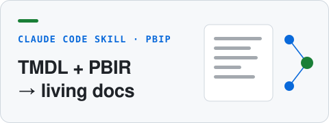</picture>

**[pbip-doc](https://github.com/ludodelot/pbip-doc)** 
Claude Code skill that **documents a Power BI project from its source**: reads TMDL and PBIR, traces measure dependencies, flags orphans and circular DAX, writes Markdown docs and a quality report.

`Claude Code` `TMDL` `PBIR` `DAX lineage`

</td>
<td width="50%" valign="top">

<picture><source media="(prefers-color-scheme: dark)" srcset="./assets/dark/cards/pbip-manual.svg"></picture>

**[pbip-manual](https://github.com/ludodelot/pbip-manual)** 
Turns a PBIP report into a **16:9 PDF user manual** in English, Spanish, Italian and French: one page per report page with wireframe, zones, sources, refresh and main KPI. Offline, read-only.

`Python` `reportlab` `PBIR` `unit tests`

</td>
</tr>
</table>

### Data modeling & SQL

<table>
<tr>
<td width="50%" valign="top">

<picture><source media="(prefers-color-scheme: dark)" srcset="./assets/dark/cards/star-schema.svg">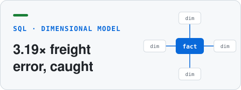</picture>

**[Northwind Star Schema](https://github.com/ludodelot/sql-star-schema-northwind)** 
Star schema from a flat sales export, six analytical queries and **twelve data-quality assertions**. The export mixes two grains: summing freight at the wrong one overstates it **3.19×**, and the build fails if any check does.

`PostgreSQL` `BigQuery` `dimensional modeling` `data quality`

</td>
<td width="50%" valign="top">

<picture><source media="(prefers-color-scheme: dark)" srcset="./assets/dark/cards/ecom-dbt.svg"></picture>

**[ecom-warehouse-dbt](https://github.com/ludodelot/ecom-warehouse-dbt)** · *in progress* 
Modern data stack on public e-commerce data: **BigQuery + dbt** with staging → marts, explicit grain, data tests, lineage and a KPI layer (GMV, AOV, conversion, retention).

`BigQuery` `dbt` `SQL` `analytics engineering`

</td>
</tr>
</table>

### AI agents & LLM tooling

<table>
<tr>
<td width="50%" valign="top">

<picture><source media="(prefers-color-scheme: dark)" srcset="./assets/dark/cards/agent-network.svg"></picture>

**[Commercial & Demand AI Agent Network](https://github.com/ludodelot/commercial-demand-ai-agent-network-showcase)** 
Specialist AI agents coordinate **demand planning, procurement, inventory and supplier agreements** through typed, auditable messages, with human approvals. Synthetic retailers and brands.

`multi-agent` `LLM` `demand planning` `supply chain`

</td>
<td width="50%" valign="top">

<picture><source media="(prefers-color-scheme: dark)" srcset="./assets/dark/cards/ats-tailor.svg"></picture>

**[ATS Resume Tailor](https://github.com/ludodelot/ats-resume-tailor)** 
Agent skill that tailors CVs to a job posting from one master profile. Every bullet cites an evidence id and **a validator fails the build on any unsupported number, title or date**.

`agent skill` `Python` `CI` `zero deps`

</td>
</tr>
<tr>
<td width="50%" valign="top">

<picture><source media="(prefers-color-scheme: dark)" srcset="./assets/dark/cards/moc-memory.svg"></picture>

**[Obsidian MOC Memory](https://github.com/ludodelot/obsidian-moc-memory)** 
Turns an Obsidian vault into **persistent memory for AI agents**: Map-of-Content retrieval, no-duplicate capture, and deterministic lint and index scripts. The LLM judges, scripts enforce rules.

`agent skill` `AI memory` `Python` `Obsidian`

</td>
<td width="50%" valign="top">

<picture><source media="(prefers-color-scheme: dark)" srcset="./assets/dark/cards/mcp-server.svg"></picture>

**[Product Research MCP Server](https://github.com/ludodelot/amazon-product-research-mcp)** 
**Model Context Protocol** server that gives an AI assistant `search_products` and `get_product` tools over stdio. Strict TypeScript, Zod validation, Vitest tests, ESLint. Mock catalog.

`MCP` `TypeScript` `Zod` `Vitest`

</td>
</tr>
</table>

<b>Data science, forecasting & quantitative finance</b> (10 more projects)

 

| Project | What it shows | Stack |
|---|---|---|
| [Optimal tech portfolio](https://github.com/ludodelot/rsb-quantitative-finance-tech-portfolio) | CAPM, Fama-French 3-factor, Markowitz frontier and EMH tests on 10 assets, 2016–2025 | R · Quarto |
| [Decathlon premium-member prediction](https://github.com/ludodelot/rsb-datascience-business-decathlon) | Cross-continent customer analytics and a Random Forest classifier (85.7% accuracy) | Python · scikit-learn |
| [Applied AI for business (HSBC case)](https://github.com/ludodelot/bsc-ai-empresarial-hsbc-clustering) | RFM clustering, classifier comparison, an LLM chatbot and GPT-generated executive reports | Python · LLM |
| [BlaBlaCar driver analytics](https://github.com/ludodelot/rsb-datascience-business-blablacar) | Behavior indices and Premium Club prediction on 97k trips | Python · classification |
| [Gold futures forecasting](https://github.com/ludodelot/rsb_msc_ts2026_finance_team1) | SES, Holt, Holt-Winters and auto-ARIMA; Holt-Winters multiplicative wins on RMSE, MAE and MAPE | R · time series |
| [Clustering portfolios](https://github.com/ludodelot/rsb-datascience-finance-clustering-portfolios) | Portfolios from 105 US stocks with K-Means and hierarchical clustering over market and ESG features | Python · clustering |
| [Semiconductor econometrics](https://github.com/ludodelot/rsb-financial-econometrics-semiconductors) | Return transmission and herding: PCA, robust OLS, CSAD, EGARCH | R · econometrics |
| [PPP: Mexico × France](https://github.com/ludodelot/rsb-exchange-markets-ppp-mexico-france) | Tests absolute purchasing power parity 2020–2024 and explains the rejection | R · OLS |
| [NYC real estate + Snowflake](https://github.com/ludodelot/bsc-nyc-real-estate-snowflake-pipeline) | R exploratory analysis and a documented Snowflake lakehouse pipeline | R · Snowflake |
| [Excel → MySQL ETL](https://github.com/ludodelot/bsc-mysql-etl-la-buena-vista) | ETL from spreadsheets into MySQL plus business SQL queries | MySQL · SQL |

##  Stack

<b>BI & MODELING</b> 

<b>DATA ENGINEERING & ANALYSIS</b> 

<b>AI & ENGINEERING</b> 

##  How I work

<picture><source media="(prefers-color-scheme: dark)" srcset="./assets/dark/pipeline.svg"></picture>

- **One definition per KPI**, written down before the visual is built.
- **Models live in Git** and get reviewed like code.
- **AI cites its sources** and never invents a number.

##  Experience

<table>
<tr><td valign="top" width="28%">

**[LVMH](https://www.linkedin.com/company/lvmh)** 
Feb 2025 – present Mexico City · France · Madrid

</td><td valign="top">

**Data & Business Intelligence (Power BI) Intern** · Beauty Tech, Global Data & AI · Madrid · *Jun 2026 – present* 
**Commercial Business Analyst Trainee** · Mexico City, then remote from France · *Feb 2025 – Jun 2026*

- Proposed and led the Excel → Power BI transformation for Loewe and Acqua di Parma: **4 → 20+ automated dashboards** and one shared reporting source for Mexico.
- Built the **25-table model** (sell-out, stock, e-commerce, POS, launches, incentives, commissions, forecasts, quotas) and an MTD summary used by the GM LatAm, senior KAMs and Retail Managers.
- Cut recurring reporting prep from **hours to minutes** with **Python ETL** over Google Cloud (GCP) and SharePoint sources; wrote the **DAX** measures and led versioning of the worldwide Loewe and LVMH Iberia models in **PBIP with Git**.
- Built data-model changes and BI projects presented to the **Loewe executive committee**.
- Coordinate BI delivery across Business, Data, IT and Beauty Tech: requirements → KPI definitions → model logic → documentation → **data-quality controls**. Trained three people to automate the UK ETL.

</td></tr>
<tr><td valign="top">

**[El Puerto de Liverpool](https://www.linkedin.com/company/elpuertodeliverpool)** 
Aug 2024 – Feb 2025 Mexico City

</td><td valign="top">

**Automation Business Analyst** · Digital CoE, Finance
- Evaluated the ROI of a **$27K USD** UiPath Insights investment; the business case showed it was not worth pursuing.
- Built RPA ROI dashboards and performance monitoring for automation projects.

</td></tr>
<tr><td valign="top">

**[EGADE Business School](https://www.linkedin.com/school/egadebusinessschool/)** 
Aug 2024 – Dec 2024 Mexico City

</td><td valign="top">

**Data Analyst Intern** · Faculty & Research Intelligence
- Power BI dashboards for publication output, SDG alignment, career development and tenure.
- Python cleaning and EDA; **OpenAI API to classify academic articles**.

</td></tr>
<tr><td valign="top">

**[Groupe SEB](https://www.linkedin.com/company/groupe-seb)** 
Feb 2024 – Aug 2024 Mexico City

</td><td valign="top">

**National CPFR Supply Chain Data Analyst**
- Demand and inventory analysis over **25,000+ SKU–store combinations** for the second-largest mass-retail client, in R and Excel.
- Flagged out-of-stock, excess and slow-moving patterns across **300+ stores** for Sales, Supply Chain and Planning.

</td></tr>
</table>

##  Education

**MSc International Management & Finance** · [Rennes School of Business](https://www.linkedin.com/school/renneschoolofbusiness/) 
Quantitative finance, econometrics, data science, forecasting, portfolio optimization, risk simulation, AI/fintech.

**BSc Business Intelligence** · [Tecnológico de Monterrey](https://www.linkedin.com/school/tecdemonterrey/) · 97/100 · 3.8/4.0 GPA 
Databases, Power BI and Tableau, Python and R, data mining, risk analysis. President of the Business Intelligence Student Committee.

<b>Certifications & honors</b>

 

**Certifications** · Microsoft Azure AI Fundamentals (AI-900) · Google Cloud Foundations · Introduction to AWS · SQL for Finance Professionals · Financial Statements in Power BI · Claude Code 101

**Honors** · Winner, Banorte Ideation & Prototyping Challenge · Winner, Patagonia Conscious Capitalism & Story Prototyping Challenge · Winner, CDL campus phase (INC MTY 2023) · Highest entering GPA scholarship, Tec de Monterrey

##  GitHub activity

<picture><source media="(prefers-color-scheme: dark)" srcset="./contrib-heatmap.svg">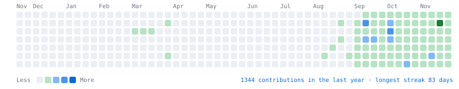</picture>

Regenerated daily by a GitHub Action in this repo from the public contribution calendar.

 

<picture><source media="(prefers-color-scheme: dark)" srcset="./assets/dark/closing.svg"></picture>

